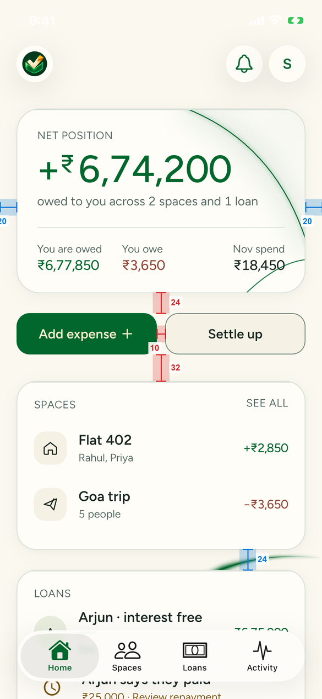
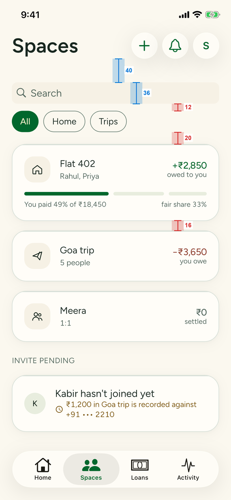
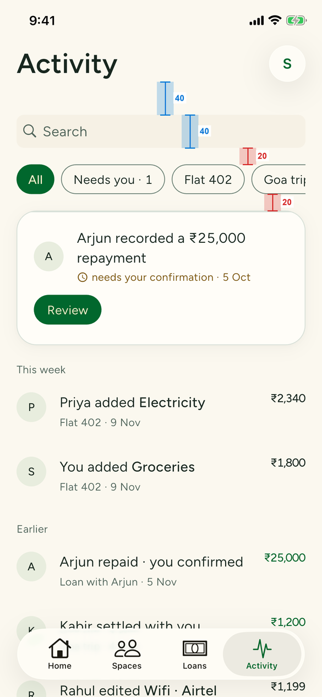
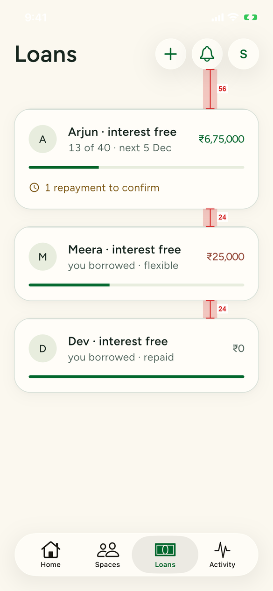
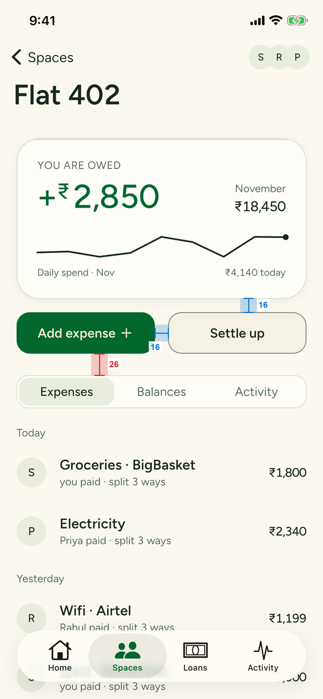
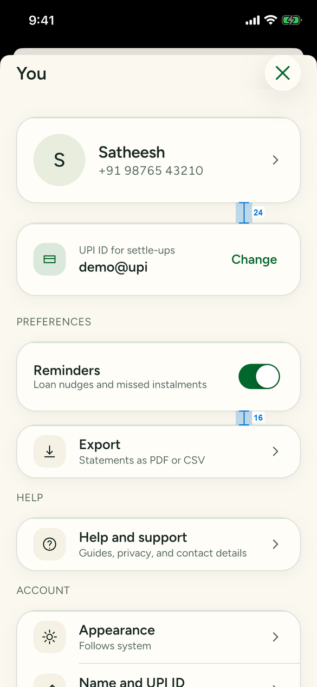

# UX quality audit, 13 Nov 2026 (#253)

**Result:** 4 Broken, 19 Awkward (including accessibility finding P5) and 11 Polish findings, plus 8 spacing findings. The owner's Settings feedback is a separate P1 issue, #254, completed in #265; B2 (#256) was completed in #264. Every Broken item has a P1 issue (#255–#258). W1–W18 are grouped into four P2 issues (#259–#262). P1–P12 (including P5) and S1–S8 are tracked together in P2 #272. This audit is read-only: it changes no app code.

Tester's words: "some things feel good, some feel awkward or broken." The good parts are real. Add expense, the four split modes, settle-up with its UPI fallback, the delete-account alert and the dark theme all held up. The problems sit at the seams: what happens *after* an action, what a sheet leaves behind, and what the small screens and large text sizes do.

## How this was tested

- **Build:** `origin/main` at `a662180`. The offline demo app is `flutter build ios --simulator --debug -t integration_test/palette_app.dart`. Two flows needed fixtures the palette app lacks, so a scratch entry (not committed) used the same fakes: `settleSpaces()` gave members UPI IDs, and `SettlingExpensesRepository` let settle-ups move balances. A `PALETTE_AUTH` build covered the signed-out flow.
- **Devices:** own simulators, created for this run and deleted afterwards. iPhone 14, 390×844 pt, iOS 26.1. iPhone SE (3rd gen), 375×667 pt, for the small-screen spot checks. iOS has no 360×800 device; the SE is the narrowest and shortest iPhone the app supports.
- **Conditions:** light and dark (`simctl ui appearance`). Text at 100%, and at 200% via `content_size accessibility-large`, which gives about 1.94× body text.
- **Input:** real HID events through SimulatorKit's `SimDeviceLegacyHIDClient`: taps, drags, keyboard keys and on-screen keypad taps. This is the path from `docs/evidence/188/simtouch.m`, extended with key events. XCUITest was not used, so accessibility-label bugs are not masked (#188).
- **Not covered:** a local Supabase stack was not run. Where the palette fakes have no side effect, the end of the flow was not verified: OTP verification flipping the session, sign-out and account deletion signing you out, and invite redemption. These flows are covered by `app/integration_test/sign_in_test.dart` and the profile tests. An installed UPI app can't exist in the simulator, so the return from a UPI app is code-read only. The dark palette was measured *before* #248 (PR #250) merged, all dark screenshots, including the tab bar, glass and B1 `picker-dark.png`, are historical pre-#250 evidence. They have not been recaptured or visually revalidated on current main; they do not establish the shipped dark appearance. The guidelines and brand tables now describe the shipped #250 tokens.

**Evidence privacy:** `se-phone-keyboard.png` is cropped to the keyboard only to remove an unverified typed number. It supports W11’s missing Done-key observation, not the field or screen layout. The phone-number regions in `new-loan-add-person.png`, `loan-name-typed.png`, `loan-name-dropped.png` and the Anu row of `new-space-sheet.png` are covered with opaque grey boxes. The visible phone suffix in Anu’s row of `invite-pending.png` is also covered. The unverified-number recordings of adding a person and losing the loan name were removed; the rows below reference stills instead. Those stills show captured states, not the intervening interactions. The initial visual/OCR pass missed the Anu contact number, as identified in PR #263 review. All 47 stills were subsequently reopened and checked by eye, including contact rows and pending-invite suffixes; the two additional masks were visually checked after saving. No other unmasked non-fixture phone numbers were found in those stills; the Settings/Profile phone and Kabir pending-invite suffix match committed fixtures, and the confirmation reference is a UPI reference. The earlier video check sampled all 12 original videos at two frames per second (206 frames), with OCR and visual spot-checks; it was not a frame-by-frame visual review and was not repeated in this still-image follow-up.

Fixture artefacts were ruled out before anything was logged. Examples: Activity still showed a repayment after it was confirmed on the loan, because the fakes don't share state. The new loan got a 24-hour reminder cooldown, because `FakeReminders` keeps one global cooldown. Neither is listed.

## Settings (owner feedback, first): #254 — completed in #265

The owner flagged Settings/Profile directly. The following observations are historical, resolved by #265. It was one P1 issue, **#254 "Settings screen polish"**, with causes and fixes:

- **The header is flush to the sheet top.** The "You" row and its 44 pt ✕ start 0 pt below the sheet edge, with no grabber. Other task sheets put the title about 55 pt lower. Cause: `packages/features/profile/lib/src/screens.dart:31-41` and `:101-125`.
- **The ✕ is a jade-tinted (marigold in dark) native glass button on the right**, unlike every other sheet's plain ✕ on the left. Cause: `screens.dart:113-122`.
- **"You" is a small `title2` beside a big circle** and reads as a stray letter. Proposal: a centred "Profile" title.
- **Spacing:**
  - Header → first card is 32.
  - Section labels float 28 above and 16 below their cards.
  - `16` literals bypass the tokens.
  - Cause: `screens.dart:45`, `:52-62`. Proposal: label → card 8, card → label 24.
- **Scroll:**
  - When scrolled, the pinned header has no backing, so cards ghost under "You" and the ✕.
  - A drag from the header while scrolled moves the sheet *and* rubber-bands the list at once (two scroll owners).
  - Cause: `packages/core/lib/widgets/platform_page.dart:93-104` (`holdsDrag: false` at `:98`), `_SheetNavigator` at `:116-150`.

Evidence: `settings-top.png`, `settings-spacing.png`, `settings-scrolled.png`, `settings-scrolled-max.png`, `settings-dark-scrolled.png`, `settings-nested-drag.png`, `settings-scroll.mp4`.

## Findings

Ranked Broken > Awkward > Polish, then by reach. Evidence paths are relative to `docs/evidence/253/`.

### Broken

| # | Screen | Steps | Expected vs actual | Evidence | Proposed fix | Likely file:line | Issue |
|---|---|---|---|---|---|---|---|
| B1 | Every date picker on iOS: Add expense date chip, Record repayment "Paid on", New loan start | Open Record repayment, tap **Today** under Paid on | **Expected:** the wheel shows the selected day in its highlight band. **Actual:** the band is opaque, so the selected month, day and year are hidden. The rows above and below show, the choice doesn't. Same in light and dark, and on the SE. | `datepicker.mp4`, `picker-light.png`, `picker-dark.png` | `CupertinoPickerDefaultSelectionOverlay` paints *over* the selected row. Pass a translucent band, e.g. `surfaceHighest.withValues(alpha: 0.35)`. Or draw the band behind the wheel and keep the default overlay transparent. The same helper is used by `showSettloPicker`. | `packages/core/lib/widgets/controls.dart:133-140` | #255 |
| B2 | Space detail → Activity segment | Spaces → Flat 402 → tap **Activity** in the Expenses / Balances / Activity control | **Expected:** this space's activity, with back to Flat 402. **Actual:** the app jumps to the global Activity *tab*, unfiltered. The space context and back path are lost. | `space-activity-segment.mp4`, `space-activity-segment.png` | Route to Activity with the space preselected, e.g. `/activity?space=<id>` read by the filter chips. Or render the space's activity in place as a third segment. | `packages/features/spaces/lib/src/space_detail.dart:413` (`SettloRoutes.activity`) | #256 — done in #264 |
| B3 | New loan → Loans list / Loan detail | Loans → **+** → 5000, phone, name "Ravi" → **Add person** → **Create loan and share** → back to Loans | **Expected:** the loan is labelled "Ravi". **Actual:** the name is discarded. The row reads "[phone redacted] · int…" with a "+" avatar, and the detail header reads a truncated phone number. The typed name is lost input. | `loan-name-typed.png`, `loan-name-dropped.png` | Send the creator's label with `create_loan`, as spaces do with `space_members.label`, and show it until the counterparty joins. `NewLoan` has no name field today. | `packages/features/loans/lib/src/new_loan_sheet.dart:73`; `packages/core/lib/supabase/loans.dart:213-220` (`NewLoan`) and `:375` (falls back to phone) | #257 |
| B4 | Tab bar on iPhone SE (home-button devices) | Launch on iPhone SE (3rd gen), light mode | **Expected:** a light glass bar with readable labels above the screen edge. **Actual:** a dark grey capsule in light mode, and the labels are cut off by the bottom edge. Spaces is green on grey. Taps still work. | `se-tab-bar.mp4`, `se-tab-bar.png`, `se-tab-bar-spaces.png` | With no bottom safe-area inset, the native `UITabBar` floats lower than the 49 pt fallback the Flutter host reserves. Use the bar's reported frame, including its floating margin, and check `overrideUserInterfaceStyle` on the host view on that device. | `app/lib/native_tab_bar.dart:20-21`, `app/lib/shell.dart:79`, `app/ios/Runner/NativeTabBar.swift:89` | #258 |

### Awkward

| # | Screen | Steps | Expected vs actual | Evidence | Proposed fix | Likely file:line | Issue |
|---|---|---|---|---|---|---|---|
| W1 | Every screen after a sheet, light mode | Home → **Add expense** (or Settle up, New space) → close the sheet | **Expected:** dark status-bar text on the cream background. **Actual:** the status bar turns white and stays white across tabs until a screen with its own style appears, so the time and battery are unreadable. | `status-bar-after-sheet.mp4`, `status-bar-white.png` | `CupertinoSheetRoute` switches to a light overlay style and nothing restores it. Wrap the shell (or `SettloScrollScaffold`) in an `AnnotatedRegion<SystemUiOverlayStyle>` that follows brightness, as Welcome does. | `packages/core/lib/widgets/platform_page.dart:187`; compare `packages/features/auth/lib/src/welcome_screen.dart:34` | #259 |
| W2 | Confirm repayment | Home → "Arjun says they paid" → **Confirm ₹25,000 received** | **Expected:** a clear success, such as "Confirmed. ₹6,50,000 left", then back to the loan. **Actual:** the page stays, and the guidance swaps to "This repayment has already been answered and is read-only." That reads like an error. | `confirm-repayment.mp4`, `confirm-repayment-after.png` | After the user's own confirmation, show a success line or notice and pop back. Keep the read-only copy for answers made elsewhere. | `packages/features/loans/lib/src/confirm_repayment.dart:157` | #259 |
| W3 | Reminder-permission explainer | Open Profile on a fresh install, or tap **Remind** on a loan | **Expected:** a native iOS alert, shown when the user asks for reminders. **Actual:** a Material `AlertDialog` (green tint, Material buttons). It interrupts opening Profile, and interrupts Remind, which nudges the *other* person. | `remind-permission-dialog.mp4`, `profile-permission-dialog.png`, `remind-permission-dialog.png` | Use `showSettloAlert` on iOS. Ask only when the user turns the Reminders toggle on, not on opening Profile. On Remind, send first and offer notifications afterwards. | `packages/platform/lib/src/reminder_permission.dart:39-41`; `packages/features/profile/lib/src/reminder_toggle.dart:28-34` | #259 |
| W4 | Space detail → Balances | Flat 402 → **Balances** → **Remind** beside "Priya pays you" | **Expected:** a reminder to Priya. **Actual:** the Settle up sheet opens on "Record cash or bank payment". | `balances-remind-opens-settle.mp4`, `balances-remind-opens-settle.png` | Rename it **Settle** or **Request**, or make it a real nudge as loans have. | `packages/features/spaces/lib/src/space_detail.dart:952` | #260 |
| W5 | Space detail segmented control | Flat 402 → tap **Balances** | **Expected:** the control stays under the finger. **Actual:** the hero card and buttons disappear on Balances, so the control jumps about 285 pt up. A second tap at the same spot lands on the content. | `space-segment-jump.mp4`, `space-expenses-tab.png`, `balances-tab.png` | Keep the hero on all three segments, or pin the control at the top on every segment. | `packages/features/spaces/lib/src/space_detail.dart:395-413` | #260 |
| W6 | New space, New loan | Type a phone number and name, then tap **Create** | **Expected:** the typed person is included. **Actual:** they aren't until **Add person** is tapped, an extra step with an unclear label. After Add person, focus lands on "Their name" rather than the phone field. | `new-loan-add-person.png`, `new-space-sheet.png` | Commit a valid pending row on Create. Rename the button **Add another**, and refocus the phone field. | `packages/features/loans/lib/src/new_loan_sheet.dart:310`; `packages/features/spaces/lib/src/create_space_sheet.dart:261` | #261 |
| W7 | Edit expense | Flat 402 → tap an expense | **Expected:** the same editor as Add expense. **Actual:** a different sheet. The amount is a small outlined field, and payer, split and date can't be changed. **Delete expense** is plain text with a "tap again" confirm. | `edit-expense.png` | Reuse `AddExpenseSheet` in edit mode. Put Delete in a destructive row with an alert, per HIG decision 1. | `packages/features/spaces/lib/src/space_detail.dart:1231-1255` | #261 |
| W8 | Settle up, you pay | Settle up → You pay Kabir → **I already paid in cash** | **Expected:** the payment is recorded, or one confirm. **Actual:** a second question, "Did you pay Kabir ₹3,650?", with Yes / Not yet. A stale red "no UPI app" error from the earlier tap stays on screen. | `settle-cash-double-confirm.png` (the stale error is in the same shot) | "I already paid" should record (with Undo), or go straight to the summary. Clear `_error` when the mode changes. | `packages/features/settle/lib/src/settle_sheet.dart:155`, `:266` | #261 |
| W9 | Settle up, they pay, no UPI ID | Flat 402 → Settle up → Priya pays you (your UPI ID unset) | **Expected:** a way to add your UPI ID. **Actual:** the disabled option says "Add your UPI ID in Profile", with no link. You must close two sheets and find Profile. | `balances-remind-opens-settle.png` | Make the line a button that opens the Name and UPI ID page in a sheet, then returns. | `packages/features/settle/lib/src/settle_sheet.dart:203` | #261 |
| W10 | Add expense → Shares | Switch split to **Shares** | **Expected:** everyone starts at 1 share. **Actual:** everyone starts at 0, and Save is disabled until each share is typed. | `shares-default-zero.png` | Seed 1 per member, as Equally does. | `packages/features/expenses/lib/src/add_expense_sheet.dart:160-170` | #261 |
| W11 | Sign in → phone (SE) | Welcome → Continue → type 10 digits | **Expected:** a way to submit from the keypad. **Actual:** the phone pad has no return key. **Send code** is under the keypad until you scroll to dismiss it. | `se-phone-keyboard.png` | Add a Done accessory or auto-advance at 10 digits, as OTP auto-submits. Or pin the action above the keyboard. | `packages/features/auth/lib/src/phone_screen.dart:100`, `:151` | #261 |
| W12 | Pending invite (Spaces) | Spaces → tap "Anu hasn't joined yet" | **Expected:** a visible Invite / Resend action. **Actual:** the whole card silently opens WhatsApp. There is also no way to add a member to an existing space; the avatar stack in Space detail looks tappable and does nothing. | `invite-pending.png` | Give the card a labelled **Send invite** button. Add "Add people" to Space detail, behind the avatar stack. | `packages/features/spaces/lib/src/spaces_list.dart:388`; `packages/features/spaces/lib/src/space_detail.dart:138` | #260 |
| W13 | Sheet chrome | Compare New space with New loan and Add expense | **Expected:** one pattern for task sheets. **Actual:** New space has a Cancel / Create bar and no grabber. New loan, Add expense and Settle up have an ✕ and a bottom primary button, with a grabber. The space and payment pickers show a blurred empty title band (see P1). | `new-space-sheet.png`, `new-loan-add-person.png`, `space-picker-sheet.png` | Pick one task-sheet layout (✕ + bottom primary) and use it for Create space. | `packages/features/spaces/lib/src/create_space_sheet.dart:300-310` | #260 |
| W14 | Back controls | Compare Confirm repayment with Loan detail | Confirm uses a round chevron button. Loan and Space detail use "‹ Loans" / "‹ Spaces" text. | `confirm-header-band.png`, `loan-detail-truncation.png` | One back control everywhere. #252 (glass back button) already plans it; fold this case into #252. | `packages/features/loans/lib/src/confirm_repayment.dart` (header) | #260 |
| W15 | Text cut off at 100% | Loan detail; New loan; Profile; Loans list | "Arjun · since M…", "Nov 202" in the Starts field, "Remove your profile and sign-in for go…", and "[phone redacted] · int…" are cut off at the default text size on a 390 pt screen. | `loan-detail-truncation.png`, `new-loan-starts-truncated.png`, `profile-truncation.png`, `loan-name-dropped.png` | Let these wrap to a second line. Drop "since …" to its own line. Shorten the Starts label to "Nov '26" or widen that column. | `packages/features/loans/lib/src/loan_detail.dart:187-188`; `packages/features/loans/lib/src/new_loan_sheet.dart:403`; `packages/features/profile/lib/src/screens.dart:322` | #262 |
| W16 | Add expense at 200% | Text size AX2 → Add expense → Split | "Equally" shows as "Equall" and "Shares" as "Share". | `split-200pct.png` | Let `SSegmentedControl` fall back to a stacked list or a menu when labels don't fit. Never clip a label to `maxLines: 1` without scaling. | `packages/core/lib/widgets/chips.dart:120` | #262 |
| W17 | Welcome on iPhone SE | Launch signed out on the SE | **Expected:** the primary action is visible. **Actual:** only a sliver of **Continue with phone number** shows at the bottom edge; you must scroll to find it. | `se-welcome-cta.mp4`, `se-welcome-fold.png` | On short screens, pin the CTA to the bottom safe area and let the illustration scroll behind it. Or drop the example cards below 700 pt height. | `packages/features/auth/lib/src/welcome_screen.dart:235` | #262 |
| W18 | Errors in Profile on iOS | Help and support or Delete account fails | Errors use a Material `SnackBar`. `showSettloNotice` exists precisely because "iOS has no snackbars". | code read (`grep showSnackBar`) | Use `showSettloNotice`. | `packages/features/profile/lib/src/screens.dart:371`, `:417`, `:454` | #259 |

| P5 | Inline Confirm received / Didn't get it | Tap either inline repayment pill | **Expected:** at least 44 × 44 pt touch targets. **Actual:** the 36 pt pills also have a 36 pt hit area, violating the accessibility rule. | `loan-confirm-inline.png` | Expand both hit areas to at least 44 × 44 pt; keep the 36 pt visual only inside that target. Verify edge taps, no overlap and 200% text. | `packages/features/loans/lib/src/loan_detail.dart:566` | #272 |

### Polish

All P-items are tracked in **#272**. P5 retains its ID for evidence continuity but is classified as Awkward/accessibility above.

| # | Screen | Observation | Evidence | Proposed fix | Likely file:line |
|---|---|---|---|---|---|
| P1 | Space and payment pickers (New expense, Settle up list) | A blurred empty band sits between the title and "WHICH SPACE?", like a collapsed large title. | `space-picker-sheet.png` | Remove the reserved large-title band when there is no large title. | `packages/core/lib/widgets/scroll_scaffold.dart` |
| P2 | Pushed screens, scrolled | Loan and Space detail scroll content under the status bar with only a fade. Confirm repayment draws a solid green band that starts below the status bar. | `confirm-header-band.png` | One scrolled-header treatment: glass bar to the top edge. | `packages/core/lib/widgets/scroll_scaffold.dart` |
| P3 | New loan amount | Principal shows "5000" while Add expense shows "1,200". | `new-loan-add-person.png` | Format with Indian grouping while typing, in one shared amount field. | `packages/features/loans/lib/src/new_loan_sheet.dart:179` |
| P4 | Loan repayments list | The date column wraps "13 May" onto two lines, and a back-dated repayment sorts above newer ones. | `repayment-date-wrap.png` | Widen the date column to fit "13 May" at 100%. Sort by paid-on date. | `packages/features/loans/lib/src/loan_detail.dart` (row, `left: 56`) |
| P6 | Icons at 200% | The "+" in Add expense, the clock on "1 repayment to confirm", and row icons stay at 100% size while the text doubles. | `home-200pct.png`, `loans-200pct.png` | Scale glyphs with `MediaQuery.textScalerOf` up to about 1.5×. | `packages/features/balances/lib/src/screens.dart:468-472` |
| P7 | Home → Loans card | The progress bar sits under the "Arjun says they paid" row, not under the Arjun loan row it measures. | `home-loans-card.png` | Move the bar under its loan row. | `packages/features/balances/lib/src/screens.dart` (`_LoansCard`) |
| P8 | Statement share | The share sheet shows "PDF • 14 KB" with no file name. | `statement-share.png` | Name the file, e.g. `Loan-Arjun-2026-11.pdf`. | `packages/features/loans/lib/src/statement_button.dart` |
| P9 | iOS text fields | New loan, New space, Edit expense and Profile use Material floating labels; Add expense uses placeholders. | `new-loan-add-person.png`, `edit-expense.png` | Use the placeholder + section-label pattern from Add expense. | `labelText:` in `new_loan_sheet.dart:295`, `create_space_sheet.dart:179`, `space_detail.dart:1231`, `profile/screens.dart:737` |
| P10 | Space and loan header bells | The bell on Spaces and Loans opens the Activity tab, which is also in the tab bar. | — | Fine if intended (#197). Show the unread count on the Activity tab item instead. | `packages/core/lib/widgets/tab_actions.dart` |
| P11 | Request via UPI | "Request via UPI" sends a WhatsApp message, but the label doesn't say so until the subtitle. Labels also differ by direction: "Record cash or bank payment" vs "I already paid in cash". | `settle-request-upi.png` | Use "Request on WhatsApp" and "Record cash or bank payment" in both directions. | `packages/features/settle/lib/src/settle_sheet.dart:193-266` |
| P12 | Settle list after a settle-up | When one payment is left plus a waiting one, the "N PAYMENTS" header disappears, and there is no "all settled" state. | — | Keep the header and show "Waiting for Kabir" as its own section. | `packages/features/settle/lib/src/screens.dart` |

## Spacing

S1–S8 are tracked in **#272**, alongside P1–P12.

Measured on 390×844 light screenshots at 3×, using pixel transitions on a fixed column, so ±0.5 pt. Tokens: `SettloSpacing` in `packages/core/lib/theme/tokens.dart` (4 / 8 / 16 / 24 / 32 / 40 / 48, screen margin 20, touch target 44).

**What holds:** the left and right insets are 20 / 20 on every tab screen and sheet. Profile follows a clear rule: 16 between cards in a section, 24 between groups. Cards on Loans, Home and Profile share radii and edges.

| # | Screen | Element | Measured | Expected token | Severity | Source |
|---|---|---|---|---|---|---|
| S1 | Home | Add expense ↔ Settle up gap | 10 | `x2` 16 (Space detail uses 16) | Awkward | `packages/features/balances/lib/src/screens.dart:477` |
| S2 | Home | Hero card → action buttons | 24 | `x2` 16 (Space and Loan detail use 16) | Polish | `balances/lib/src/screens.dart:27` (`gap`) |
| S3 | Home | Action buttons → Spaces card | 32 | `x3` 24 (every other card gap on Home is 24) | Polish | `balances/lib/src/screens.dart:115` |
| S4 | Spaces vs Loans | Gap between list cards | 16 vs 24 | One list-card gap; `x2` 16 | Awkward | `spaces/lib/src/spaces_list.dart:157` vs `loans/lib/src/screens.dart:91` |
| S5 | Spaces vs Activity | Search → filter chips | 12 vs 20 | `x2` 16 in both | Polish | `spaces/lib/src/spaces_list.dart:117-119` vs `activity/lib/src/screens.dart:190` |
| S6 | Spaces vs Activity | Search field height | 36 vs 40 | 36 drawn in a 44 target, both | Polish | both build `SSearchField` (`packages/core/lib/widgets/controls.dart:197`); find the parent that adds 4 on Activity |
| S7 | Loans vs Spaces / Activity | Header → first content | 56 vs 40 | `x5` 40 on every tab root | Polish | `loans/lib/src/screens.dart:58` |
| S8 | Space detail | Buttons → segmented control | 26 | `x3` 24 | Polish | `spaces/lib/src/space_detail.dart:395` (track drawn 40 inside a 44 band, plus the `x3` above) |

Hard-coded spacing outside tokens: 139 `SizedBox` / `EdgeInsets` literals in `packages/features` and `packages/core/lib/widgets`. Of those, 46 are off the 4 pt scale (2, 3, 5, 6, 7, 10, 14, 18, 19, 21, 22, 25). The most are in `balances/lib/src/screens.dart` (15), `core/lib/widgets/amount_sheet.dart` (7) and `spaces/lib/src/space_detail.dart` (5). Only 2 pt optical nudges with a comment and the `half` 4 pt token are allowed by the guidelines; other literals need review in #272. Gaps *between* siblings should all be tokens.

Annotated screenshots (red: off-rule, blue: on-rule):

| Home | Spaces | Activity |
|---|---|---|
|  |  |  |

| Loans | Space detail | Profile |
|---|---|---|
|  |  |  |

**Proposed token rules**, now in [docs/ui-guidelines.md](../ui-guidelines.md#spacing):

| Use | Token |
|---|---|
| Screen margin, left and right | `screenMargin` 20 |
| Tab-root header → first content | `x5` 40 |
| Between sections, and hero → next section | `x3` 24 |
| Between cards in one list or section | `x2` 16 |
| Section label → its card | `x1` 8 |
| Card padding | `x3` 24 (`x2` 16 for compact rows) |
| Between rows inside a card | `x2` 16 |
| Between buttons in a group, side by side or stacked | `x2` 16 |
| Hero card → its action buttons | `x2` 16 |
| Optical nudge inside one component | `half` 4, or a 2 pt literal with a comment |

## Coverage

| Flow | 390 light | 390 dark | 200% text | SE | Result |
|---|---|---|---|---|---|
| Sign-in: welcome, phone, OTP | ✓ | ✓ | — | ✓ | W11, W17. OTP auto-submits; session flip not verified (fake) |
| Create a space and invite | ✓ | — | — | — | W6, W12, W13 |
| Add expense: Equally, Exact, %, Shares | ✓ | ✓ | ✓ | ✓ | W10, W16, B1. Values survive mode switches |
| Edit / delete expense | ✓ | — | — | — | W7 |
| Settle up: UPI hand-off, cash, confirm arrival | ✓ | — | — | — | W8, W9, P11. No-UPI-app fallback is clear |
| Create loan → record → confirm repayment | ✓ | ✓ | ✓ | — | B1, B3, W2, W3, P4, P5 |
| Activity, notifications (bell) | ✓ | — | ✓ | — | B2, P10 |
| Profile / Settings, theme switch | ✓ | ✓ | ✓ | — | #254, W3, W15, W18. Theme switches instantly |
| Account deletion | ✓ (to the confirm) | ✓ | — | — | The native alert is right; sign-out after deletion not verified (fake) |
| Tab bar | ✓ | ✓ | ✓ | ✓ | B4 |

## Fix plan

Small PRs, in order:

1. **Done in #265 — #254:** Settings screen polish (owner-requested): header, ✕, spacing tokens and one drag owner.
2. **#255** Picker overlay translucency: one line plus a golden. **#259, part 1:** an `AnnotatedRegion` for the status bar.
3. **Done in #264 — #256:** Space-filtered Activity route. **#257** Loan label through `create_loan` (a migration plus the app).
4. **#258** SE tab bar height and appearance, needing a device check on a home-button iPhone.
5. **#259** Feedback after actions: confirm-repayment success, a native permission explainer asked at the right moment, and `showSettloNotice` in Profile.
6. **#261** Forms, one PR per sheet: Shares default, Add person, Edit expense reuse, the settle double confirm, the phone pad Done.
7. **#260** Navigation and labels: Remind rename, segment pinning, Create space chrome, the invite affordance. #252 covers back buttons.
8. **#262** Large text and small screens: wrapping, the segmented-control fallback, the SE Welcome CTA.
9. **#272:** P1–P12 and spacing S1–S8, prioritising the P5 44 × 44 pt accessibility fix; regenerate goldens using the shipped #250 palette.
